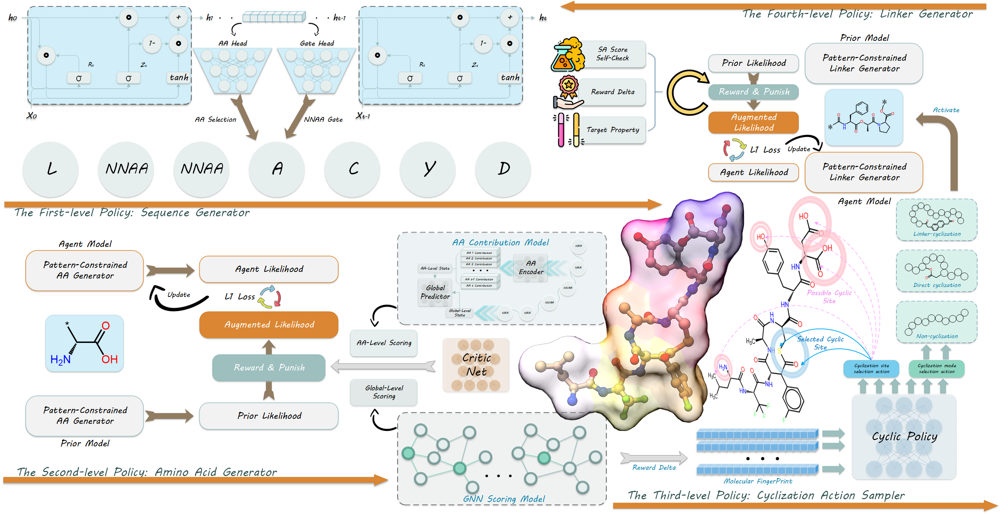

# 🧪 De Novo Design of Peptidomimetics via Hierarchical Coupling Reinforcement Learning

---

## 📄 Abstract
> **Abstract**
<p align="center">
  
</p>
Peptidomimetic design is fundamentally constrained by the strong coupling among noncanonical residues, sequence composition, and molecular topology within rugged, multi-objective fitness landscapes. To address this challenge, we developed PepBrick, a structured multi-level nested reinforcement learning framework that hierarchically represents peptidomimetics and decomposes the design process into controllable decision steps. By enabling coordinated optimization of chemical composition and molecular topology under multiple constraints, PepBrick provides a flexible strategy for navigating complex peptidomimetic design spaces. Systematic evaluation at both the component and integrated levels demonstrated its robust design capability. Moreover, the de novo design of blood-brain-barrier-penetrating neuropeptidomimeticss and tumor-targeting fluorescent probes, together with proof-of-concept molecular dynamics simulations, further demonstrated its effectiveness in navigating strongly coupled, multi-objective fitness landscapes. Collectively, these results establish PepBrick as a general computational framework for programmable peptidomimetic design and the development of next-generation peptide-based functional molecules.

---

## 🖼️ Overview
> **The PepBrick framework：** (i) Sequence Generation Module: Selects canonical amino acids from the candidate pool or activates the unnatural amino acid generation module when needed. (iii) Amino Acid Generation Module: Activated by the sequence generation module to produce diverse unnatural amino acid structures. (ii) Cyclization Policy Module: Determines the cyclization strategy and sites for linear peptidomimetics and decides whether to activate the linker generator. (iv) Linker Generation Module: Activated by the cyclization policy module to generate structurally feasible linker molecules. (v) Scoring Module: Incorporates a global-level graph neural network encoder, an amino-acid-level language model, and a Critic network to enhance training stability. This module outputs the reward signal for generated peptidomimetics and updates the parameters of the entire PepBrick framework.

<p align="center">
  
</p>


---

## ⚙️ Environment Requirements

- **Python**: >= 3.8
- **CUDA** : >= 12.6
- **Key Dependencies**:
  ```text
  torch = 2.5.1
  numpy = 1.26.4
  pandas = 2.3.3
  scikit-learn = 1.6.1
  rdkit = 2025.03.5
  openbabel = 3.1.1
  torch_geometric = 2.6.1


## ⚙️ Reproducible workflow: data preparation, scoring, reinforcement learning, and sampling


### 1. Environment and example files

Create an environment and install the packages listed in the repository's environment requirements. For example, the following installs a CPU build for the scoring examples:

```bash
conda create -n pepbrick python=3.10
conda activate pepbrick
python -m pip install torch==2.5.1 --index-url https://download.pytorch.org/whl/cpu
python -m pip install numpy==1.26.4 pandas==2.3.3 scikit-learn==1.6.1 rdkit==2025.3.5 torch-geometric==2.6.1 tqdm
```

The generation workflow additionally imports `transformers` and Open Babel:

```bash
python -m pip install transformers
conda install -c conda-forge openbabel=3.1.1
```

For GPU runs, use a CUDA-enabled PyTorch build compatible with the machine and record its exact version. Record the resolved environment for each experiment:

### 2. Required scoring data

Prepare the cleaned, final CSV partitions used in the study. Do not generate a new random split when attempting to reproduce a reported result.

| Target | Input columns |
|---|---|
| CPP identification | `SMILES`, `Label` |
| Neuropeptide identification | `SMILES`, `Label` |
| Membrane permeability classification or regression | `SMILES`, `Label` |
| MOR docking-score regression | `SMILES`, `Label` |
| GRPR docking-score regression | `SMILES`, `Label` |

 Docking-score labels are computational scores rather than experimentally measured affinities. 

Example CSV structure:

```csv
SMILES,Label
NCC(=O)O,1
N[C@@H](C)C(=O)O,0
```

These rows illustrate the schema only; they are not a training dataset. Sequence-based datasets must first be converted to their intended molecular structures. The graph converter expects the final molecular SMILES and does not infer modifications or cyclization from sequence strings.


### 3. Convert CSV data into molecular graphs

Molecular graphs are prepared using `Graph_dataset.py`. The input CSV path specifies the source records, while `root` specifies the directory in which the processed graph dataset is stored.

The current `read_data_labeled()` function reads molecular SMILES from `SMILES_cyc` and labels from `affinity`. If the CSV uses different column names, update these names in `read_data_labeled()` accordingly.

Remove the original module-level input-loading statements:

```python
path = r'Data\Dataset'
labeled_data = read_data_labeled(path)
```

Then append the following code after the `DatasetWithLabel` class definition in `Graph_dataset.py`:

```python
if __name__ == "__main__":
    from pathlib import Path

    csv_dir = Path("Data/Dataset/NeuroPep")
    graph_dir = Path("Data/Dataset/graph_data")

    for split in ["train", "valid", "test"]:
        path = str(csv_dir / f"{split}.csv")
        labeled_data = read_data_labeled(path)

        root = str(graph_dir / f"Neuro_{split}")
        dataset = DatasetWithLabel(root=root)

        print(f"{split}: {len(dataset)} graphs")
        print(f"Output: {dataset.processed_paths[0]}")
```

Run the conversion from the repository root:

```bash
python "GNN Scoring/Graph_dataset.py"
```

For each record, RDKit parses the SMILES into a molecule, and `mol_to_graph_data()` constructs its graph representation. The molecular label is stored as `data.label`. The resulting graphs are collated and saved as:

```text
Data/Dataset/graph_data/Neuro_train/processed/processed_data.dataset
Data/Dataset/graph_data/Neuro_valid/processed/processed_data.dataset
Data/Dataset/graph_data/Neuro_test/processed/processed_data.dataset
```

The scoring-model training code can subsequently load these prepared datasets by specifying their respective roots:

```python
train_dataset = DatasetWithLabel(
    root="Data/Dataset/graph_data/Neuro_train"
)
valid_dataset = DatasetWithLabel(
    root="Data/Dataset/graph_data/Neuro_valid"
)
test_dataset = DatasetWithLabel(
    root="Data/Dataset/graph_data/Neuro_test"
)
```

Use a separate root for each partition and dataset. Existing processed files are reused automatically; if an input CSV changes, remove its corresponding processed file before regenerating the graphs.


### 4. Train scoring models using graph data

The supported architectures are 'GIN', 'GCN', 'GAT', 'GraphSAGE', and 'GraphTransformer'. For architecture comparisons, use the same CSV partitions and label definitions. Use a separate output directory for every architecture, hyperparameter configuration, and seed.

The trainer uses the training partition to update model parameters. It uses the validation partition to select `best.pth` and never reads the test partition. The default selection criteria are validation accuracy for classification and validation R² for regression; validation MCC or MAE can be selected explicitly. Use the criterion actually used for the corresponding paper experiment.

Outputs are:

- `best.pth`: the validation-selected model state dictionary.
- `config.json`: architecture, optimization, label-threshold, partition, and seed settings.
- `best_validation.json`: selected epoch and validation metrics.
- `training_log.csv`: training loss and validation metrics by epoch.

- 
